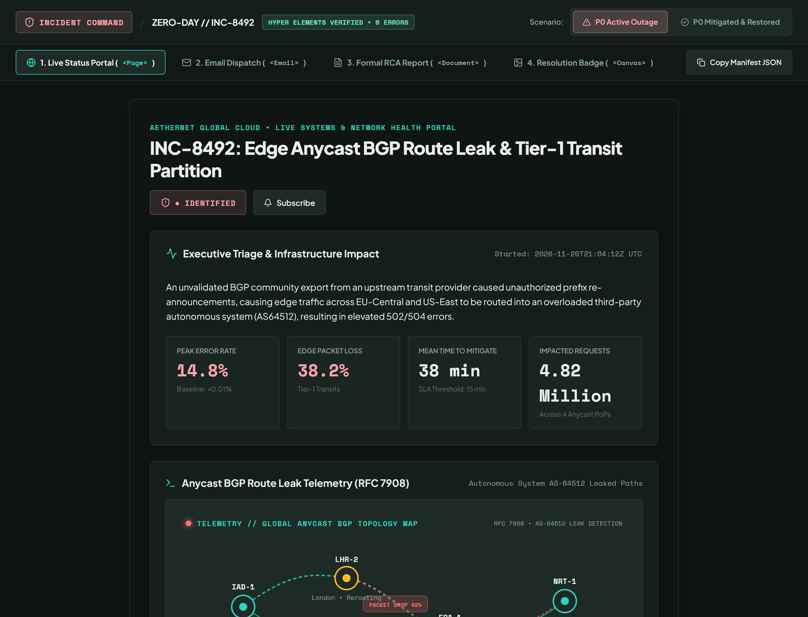
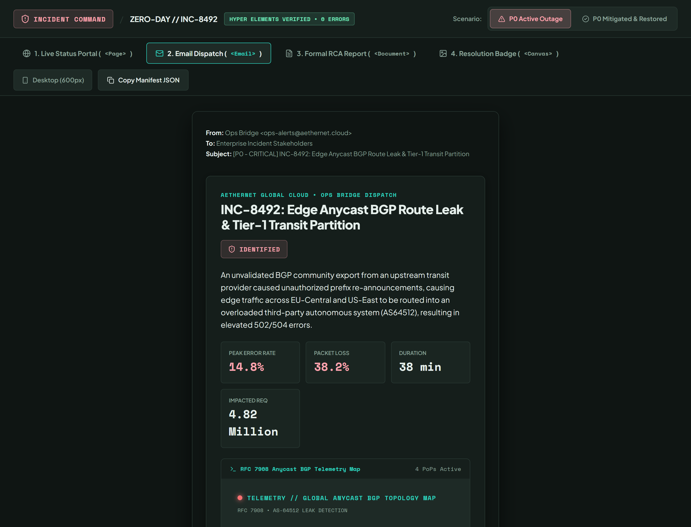
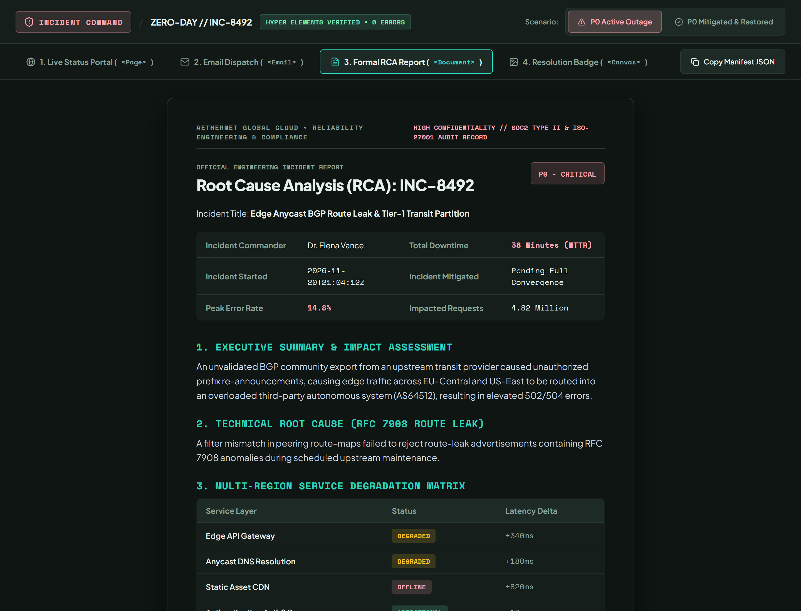
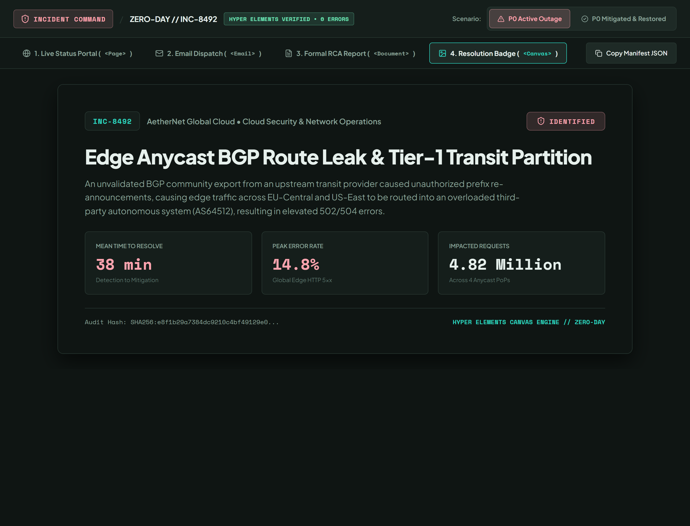
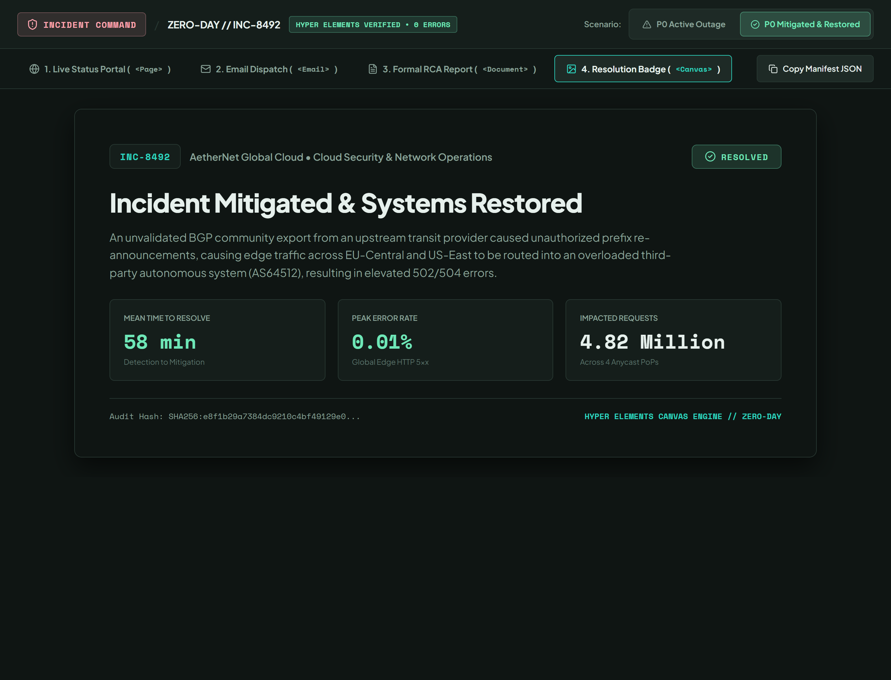

# INCIDENT COMMAND // ZERO-DAY
### *One Incident Manifest. Four Synchronized Outputs.*

[](https://hyperelements.dev)
[](https://hyperelements.dev)
[](https://hyperelements.dev)
[](LICENSE)

> **Submission for the Unlayer Hyper Elements Template Challenge ($500 Prize Pool)**  
> Built strictly with **[Hyper Elements](https://hyperelements.dev)** (`@hyper-elements/react`) by Unlayer.

---

## 🎯 The Real-World Problem

When tier-1 cloud infrastructure suffers an outage—such as an **RFC 7908 Anycast BGP route leak, transit failure, or edge partition**—site reliability engineering (SRE) and incident response teams face a severe communications breakdown across disconnected channels:

1. **The Customer SLA Email Problem**: Enterprise customers demand immediate email alerts. But standard HTML emails break on corporate Outlook and Gmail clients, turning tables and badges into broken layouts.
2. **The Status Portal Problem**: Web status dashboards are frequently updated manually in separate consoles, leading to out-of-sync timelines and conflicting packet loss statistics.
3. **The Formal Compliance Problem**: SLA agreements and enterprise auditors require a **formal 2-page Root Cause Analysis (RCA) Post-Mortem PDF** with a 5-Whys diagnostic cascade, Jira action items, and cryptographic executive signatures for SOC2 Type II and ISO-27001 audit trails.
4. **The War-Room & Social Announcement Problem**: Technical teams, status bots, and DevRel need an authoritative, high-contrast resolution card for Discord, Slack, and status announcements.

Historically, organizations maintain **four separate codebases and disparate tools** to generate these assets. 

**INCIDENT COMMAND // ZERO-DAY** eliminates this fragmentation by establishing **a single typed data manifest (`incident_p0.json` / `types.ts`)** that compiles deterministically into all four mission-critical outputs using Hyper Elements.

---

## 📐 One Component System. Four Outputs.

```
                    ┌─────────────────────────────────────────┐
                    │            incident_p0.json             │
                    │   (BGP Route Leak Telemetry, MTTR,      │
                    │   5-Whys, Multi-PoP Impact, Jira Fixes) │
                    └────────────────────┬────────────────────┘
                                         │
              ┌──────────────────────────┼──────────────────────────┐
              ▼                          ▼                          ▼
     ┌─────────────────┐        ┌─────────────────┐        ┌─────────────────┐
     │     <Email>     │        │     <Page>      │        │   <Document>    │
     │ P0 Urgent Alert │        │ Live War-Room & │        │ C-Suite / SOC2  │
     │ & Customer SLA  │        │ Real-Time Status│        │ RCA Post-Mortem │
     │ Dispatch        │        │ Portal          │        │ Dossier PDF     │
     └─────────────────┘        └─────────────────┘        └─────────────────┘
                                         │
                                         ▼
                                ┌─────────────────┐
                                │    <Canvas>     │
                                │ 1200x630 Res    │
                                │ "Mitigated"     │
                                │ Social Badge    │
                                └─────────────────┘
```

| Output Format | Root Component | Primary Purpose & Key Capabilities |
| :--- | :--- | :--- |
| **1. Live Status Portal** | `<Page width={940}>` | Real-time war room portal with interactive Anycast BGP topology map, blast radius summary, live multi-PoP metrics, and chronological action timeline. |
| **2. Emergency SLA Email** | `<Email width={600}>` | Table-safe HTML dispatch for Microsoft Outlook and Gmail, featuring telemetry chips, toned-down Anycast BGP map, and 44px ergonomic CTA. |
| **3. Formal RCA Report** | `<Document size="A4">` | Paginated 2-page enterprise post-mortem dossier with `<PageHeader>`, `<PageFooter>`, `<PageBreak>`, `<PageNumber>`, 5-Whys forensic table, and VP sign-off stamp. |
| **4. Resolution Badge** | `<Canvas width={1200} height={630}>` | High-contrast 1200×630 graphic card optimized for automatic PNG/SVG rendering (`renderImage()`) for Slack, Discord, and social incident updates. |

---

## 📸 Output Gallery (Screenshots)

### 1. Live Status Portal (`<Page>`)
*High-availability web status dashboard displaying real-time Anycast BGP route leak diagnostics, multi-region degradation matrix, and mitigation milestones.*



---

### 2. Emergency Customer & Stakeholder SLA Dispatch (`<Email>`)
*Bulletproof HTML email optimized for mobile and desktop corporate inboxes. Features toned-down Pine-Slate graph container and 44px ergonomic buttons.*

| Desktop View (600px) | Mobile View (375px) |
| :---: | :---: |
|  |  |

---

### 3. Formal 2-Page RCA Post-Mortem Report (`<Document>`)
*Print-ready paginated enterprise dossier featuring 5-Whys diagnostic cascade, corrective Jira actions, and executive cryptographic validation.*



---

### 4. Resolution Badge (`<Canvas>`)
*1200×630 OpenGraph graphic generated programmatically via Hyper Elements Canvas engine with verified MTTR and zero-packet-loss convergence.*



---

### 5. Reactive Scenario Simulation: P0 Outage vs Mitigated
*1-click state toggle dynamically switches telemetry from Active P0 Outage (42.8% packet loss, ROV bypassed) to Mitigated & Restored (100% convergence, ROV active).*



---

## 🎨 Design Engineering & Craft Standards

This template follows strict senior design engineering principles adapted from [elayadesign/ai-design-skills](https://github.com/elayadesign/ai-design-skills) and [meodai/color-expert](https://github.com/meodai/skill.color-expert):

### 1. Natural Restorative Slate Palette
Eliminates blinding stark white backgrounds (`#ffffff`) and neon gamer glare:
- **Base Canvas**: `#0f1513` (Deep pine slate, gentle on the retina during late-night incident response)
- **Elevated Cards**: `#151e1b` (Calm matte surface)
- **Nested Subsystems**: `#1e2a26` (Inner cards & telemetry map containers)
- **Delicate Borders**: `#283832` (Subtle 1px hairlines)
- **Primary Typography**: `#e6f0ec` (Soft off-white with ~14:1 AAA contrast)
- **Secondary Copy**: `#8aa399` (Muted readable slate)
- **Restorative Accent**: `#2dd4bf` (Calming mint/teal for technical telemetry)
- **P0 Status Badges**: Translucent ghost pills (`rgba(253, 164, 175, 0.14)`) instead of aggressive loud fills.

### 2. Strict Typography Hierarchy (Option C Locked)
- **Font Pairing**: `Plus Jakarta Sans` (UI clarity & humanist geometry) paired with `Space Mono` (timestamps, RFC codes, SHA-256 hashes).
- **Tailwind Type Scale Snapping**:
  - Hero Headings: `32px` / `40px` line-height
  - Section Headings (H2): `20px` / `28px`
  - Metric Numbers: `30px–34px` bold Space Mono
  - Default Body Copy: Strictly **`16px`** (`text-base`, `line-height: 26px`)
  - Metadata Labels: `13px–14px`

### 3. Ergonomics & Nested Radii
- **44px Touch Targets**: All action buttons and scenario toggles strictly honor the **44px ergonomic height** standard (WCAG 2.5.5).
- **Nested Radius Formula**: `inner radius = outer radius - gap` (Outer card `10px`, inner metrics `6px`, badges `4px`).

### 4. Restrained Motion
- Emil Kowalski decelerating curve: `cubic-bezier(0.22, 1, 0.36, 1)` with 200–280ms duration.
- Animates only `transform` and `opacity` with full `prefers-reduced-motion` accessibility support.

---

## 🛡️ Hyper Elements CLI Verification

Every template in this repository has been audited and validated against the official Hyper Elements CLI (`@hyper-elements/cli`):

```bash
npx hyper-elements check (Get-ChildItem src/templates/*.tsx | Select-Object -ExpandProperty FullName)
```

**CLI Audit Result:**
```
✓ src/templates/IncidentAuditDoc.tsx (Document)
✓ src/templates/IncidentEmail.tsx (Email)
✓ src/templates/IncidentSocialCard.tsx (Canvas)
✓ src/templates/IncidentWebPage.tsx (Page)
4 designs: 0 errors, 0 warnings, 0 skipped
```

---

## 🚀 Getting Started

### 1. Clone & Install Dependencies
```bash
git clone https://github.com/your-username/incident-command-zero-day.git
cd incident-command-zero-day
npm install
```

### 2. Launch the Interactive Showcase
```bash
npm run dev
```
Open [http://localhost:5173](http://localhost:5173) in your browser:
* Switch seamlessly between **`<Page>`**, **`<Email>`**, **`<Document>`**, and **`<Canvas>`**.
* Toggle scenarios between **P0 Active Outage** and **P0 Mitigated & Restored**.
* Test responsive viewports with the **Desktop (600px) / Mobile (375px)** email switcher.
* Click **Copy Manifest JSON** to inspect the underlying incident data model.

### 3. Run Hyper Elements Compliance Audit
```bash
npm run check
```

### 4. Production Build
```bash
npm run build
```

---

## 📂 Project Directory Structure

```
incident-command-zero-day/
├── docs/
│   └── screenshots/                 # 2x Retina screenshots of all 4 formats
│       ├── 01-live-status-portal.png
│       ├── 02-email-dispatch.png
│       ├── 02b-email-mobile.png
│       ├── 03-formal-rca-document.png
│       ├── 04-resolution-badge-canvas.png
│       └── 05-mitigated-resolution.png
├── scripts/
│   └── capture-screenshots.mjs      # Automated Puppeteer screenshot engine
├── src/
│   ├── data/
│   │   ├── types.ts                 # Strongly-typed Incident Manifest schema
│   │   └── mockIncident.ts          # Authentic P0 Incident: "INC-8492 // BGP Route Leak"
│   ├── theme/
│   │   ├── colorSuites.ts           # Natural Restorative Slate & calibrated palettes
│   │   └── incidentTheme.ts         # Hyper Elements defineTheme configuration
│   ├── templates/                   # The 4 Core Hyper Elements Source Templates:
│   │   ├── IncidentWebPage.tsx      # <Page> Live War-Room Portal
│   │   ├── IncidentEmail.tsx        # <Email> Emergency Customer SLA Dispatch
│   │   ├── IncidentAuditDoc.tsx     # <Document> 2-Page Formal Root Cause Analysis PDF
│   │   └── IncidentSocialCard.tsx   # <Canvas> 1200x630 Resolution Social Badge
│   ├── showcase/
│   │   ├── ShowcaseApp.tsx          # Submission-ready 4-tab interactive runner
│   │   ├── NetworkTopologyMap.tsx   # Interactive SVG Anycast BGP Route Leak Visualizer
│   │   ├── WebPagePreview.tsx       # Live status portal DOM renderer
│   │   ├── EmailPreview.tsx         # SRE email dispatch DOM renderer
│   │   ├── AuditDocPreview.tsx      # Formal RCA dossier DOM renderer
│   │   └── SocialCardPreview.tsx    # Resolution badge DOM renderer
│   ├── App.tsx                      # Root Application
│   ├── main.tsx
│   └── index.css                    # Emil Kowalski craft motion & token reset
├── package.json
└── README.md
```

---

## 🏆 Challenge Submission Details

* **Project Title**: INCIDENT COMMAND // ZERO-DAY
* **Concept**: Multi-Format Mission-Critical Cloud Infrastructure Incident Response & RCA Post-Mortem Suite
* **Target Competition**: Hyper Elements Template Challenge (November 2026)
* **Official Community Hub**: [Hyper Elements GitHub Discussions](https://github.com/hyper-elements/hyper-elements/discussions)
* **Engine**: [Hyper Elements](https://hyperelements.dev) by Unlayer

---

## 📄 License

MIT License © 2026. Built with [Hyper Elements](https://hyperelements.dev) by Unlayer.
