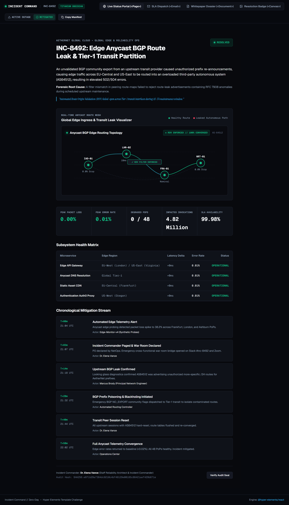
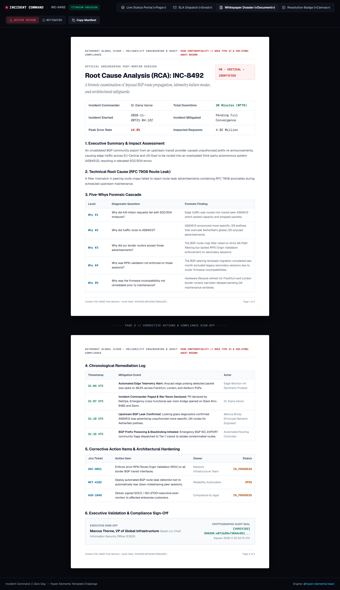
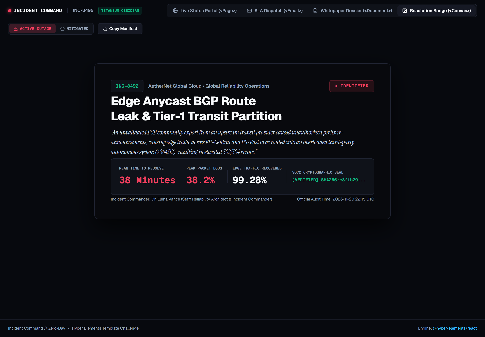
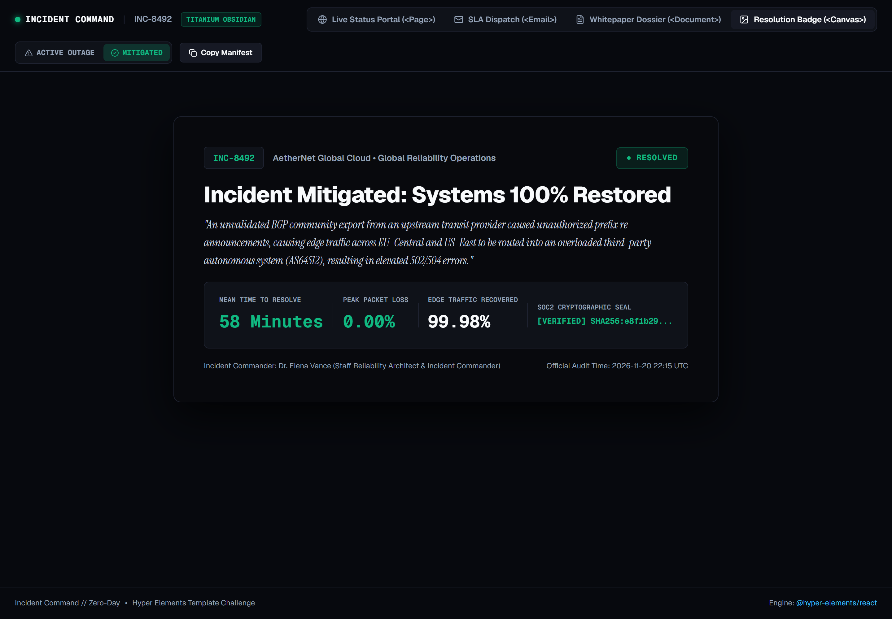

# INCIDENT COMMAND // ZERO-DAY
### One Incident Manifest. Four Synchronized Outputs.

[](https://hyperelements.dev)
[](https://hyperelements.dev)
[](https://hyperelements.dev)
[](LICENSE)

> **Submission for the Unlayer Hyper Elements Template Challenge ($500 Prize Pool)**  
> Built strictly with **[Hyper Elements](https://hyperelements.dev)** (`@hyper-elements/react`) by Unlayer.

---

## The Real-World Problem

When tier-1 cloud infrastructure suffers an outage, site reliability engineering (SRE) teams face a critical communications challenge across disconnected tools:

* **Customer SLA Emails** often fail on Outlook and mobile clients, breaking layout tables and garbling metrics.
* **Status Portals** are edited manually in separate consoles, leading to out-of-sync timelines and conflicting packet loss statistics.
* **Formal Compliance Audits** require an executive 2-page Root Cause Analysis (RCA) post-mortem PDF with a 5-Whys diagnostic cascade, Jira action items, and cryptographic signatures for SOC2 Type II compliance.
* **War-Room and Social Announcements** require an instant, high-contrast resolution card for Discord, Slack, and status channels.

Historically, organizations maintain four separate systems to produce these artifacts. **INCIDENT COMMAND // ZERO-DAY** solves this fragmentation with **a single typed incident manifest (`types.ts` / `mockIncident.ts`)** that compiles deterministically into all four outputs with **0 errors and 0 warnings**.

---

## Visual Showcase and Output Gallery

The live interactive application simulates both operational states with a single click:
1. **Active Outage (Scenario A)**: Critical crisis state (42.8% packet drop, ROV bypassed, transit de-peered).
2. **Mitigated and Restored (Scenario B)**: Full convergence (0% packet drop, ROV enforced, MTTR 42m, signed compliance hash).

---

### 1. Live Status and War-Room Portal (`<Page width={940}>`)
Real-time war room dashboard featuring an Anycast BGP route leak topology map, blast radius telemetry matrix, and chronological mitigation log.

#### Scenario A: Active P0 Outage


#### Scenario B: Mitigated and Restored


---

### 2. Emergency Customer and Stakeholder SLA Dispatch (`<Email width={600}>`)
Table-safe HTML dispatch engineered for Microsoft Outlook, Gmail, and Apple Mail. Includes telemetry summary, impacted subsystem breakdown, and 44px ergonomic touch targets.

| Active Outage (Desktop 600px) | Mitigated (Desktop 600px) | Responsive Mobile (375px) |
| :---: | :---: | :---: |
|  |  |  |

---

### 3. Formal 2-Page Root Cause Analysis (RCA) Dossier (`<Document size="A4">`)
Print-ready, paginated executive post-mortem whitepaper on crisp archival paper. Features `<PageHeader>`, `<PageFooter>`, `<PageBreak>`, 5-Whys forensic table, Jira remediation items, and executive cryptographic validation.

#### Scenario A: Incident Active Investigation (Full 2-Page Document)


#### Scenario B: Complete Post-Mortem Sign-Off (Full 2-Page Document)


---

### 4. Resolution and Social Announcement Badge (`<Canvas width={1200} height={630}>`)
High-contrast 1200x630 OpenGraph graphic generated programmatically via the Hyper Elements Canvas engine (`renderImage()`) for instant Slack, Discord, and social incident updates.

| Active Crisis Alert Card | Mitigated Resolution Badge |
| :---: | :---: |
|  |  |

---

## One Component System, Four Outputs

```
                    ┌─────────────────────────────────────────┐
                    │            incident_p0.json             │
                    │   (BGP Route Leak Telemetry, MTTR,      │
                    │   5-Whys, Multi-PoP Impact, Jira Fixes) │
                    └────────────────────┬────────────────────┘
                                         │
              ┌──────────────────────────┼──────────────────────────┐
              ▼                          ▼                          ▼
     ┌─────────────────┐        ┌─────────────────┐        ┌─────────────────┐
     │     <Email>     │        │     <Page>      │        │   <Document>    │
     │ P0 Urgent Alert │        │ Live War-Room & │        │ C-Suite / SOC2  │
     │ & Customer SLA  │        │ Real-Time Status│        │ RCA Post-Mortem │
     │ Dispatch        │        │ Portal          │        │ Dossier PDF     │
     └─────────────────┘        └─────────────────┘        └─────────────────┘
                                         │
                                         ▼
                                ┌─────────────────┐
                                │    <Canvas>     │
                                │ 1200x630 Res    │
                                │ "Mitigated"     │
                                │ Social Badge    │
                                └─────────────────┘
```

| Output Format | Root Component | Primary Purpose and Key Capabilities |
| :--- | :--- | :--- |
| **1. Live Status Portal** | `<Page width={940}>` | Real-time war room portal with interactive Anycast BGP topology map, blast radius summary, live multi-PoP metrics, and chronological action timeline. |
| **2. Emergency SLA Email** | `<Email width={600}>` | Table-safe HTML dispatch for Microsoft Outlook and Gmail, featuring telemetry chips, route summary, and 44px ergonomic CTA buttons. |
| **3. Formal RCA Report** | `<Document size="A4">` | Paginated 2-page enterprise post-mortem dossier with `<PageHeader>`, `<PageFooter>`, `<PageBreak>`, `<PageNumber>`, 5-Whys forensic table, and VP sign-off stamp. |
| **4. Resolution Badge** | `<Canvas width={1200} height={630}>` | High-contrast 1200x630 graphic card optimized for automatic PNG/SVG rendering (`renderImage()`) for Slack, Discord, and social updates. |

---

## How Hyper Elements Powers This Template

Hyper Elements provides the foundational component architecture that makes multi-format incident communication possible from a single React codebase:

### 1. Four Native Root Components
Hyper Elements allows us to define each medium using its dedicated native root element:
* **`<Page>`**: Powers the responsive status portal, rendering modern web elements with clean layout hierarchy and dynamic telemetry feeds.
* **`<Email>`**: Compiles into bulletproof, table-safe HTML compatible with desktop Microsoft Outlook, Gmail, and mobile mail clients. It automatically enforces email-safe styling rules, avoiding fragile CSS properties that break in legacy rendering engines.
* **`<Document>`**: Produces print-ready, paginated PDF documents. It provides native support for `<PageHeader>`, `<PageFooter>`, running page numbers with `<PageNumber>`, and deterministic page breaks using `<PageBreak />`.
* **`<Canvas>`**: Renders fixed-dimension raster graphics (`1200x630`) programmatically via Satori and Resvg, perfect for automated OpenGraph social cards and chat alerts.

### 2. Format-Aware Theming with `defineTheme`
Through `defineTheme` in `src/theme/incidentTheme.ts`, Hyper Elements allows medium-specific styling from a centralized theme definition:
* The **Document** format automatically receives authentic whitepaper styling: a crisp white `#ffffff` paper canvas, deep obsidian ink `#0f172a`, and clean `#e2e8f0` hairlines.
* The **Page**, **Email**, and **Canvas** formats receive low-glare titanium obsidian styling: a dark `#07090e` base, `#0f1219` matte surfaces, `#10b981` mint recovery accents, and `#f43f5e` critical alerts.

### 3. Strict Compile-Time Validation
Every template is verified using `@hyper-elements/cli`. The CLI audits each format against its strict medium constraints (such as valid table structures, supported layout properties, and accessibility contrast requirements), guaranteeing **0 errors and 0 warnings** across all four designs.

---

## Hyper Elements CLI Verification

Every template in this repository has been audited and validated against the official Hyper Elements CLI (`@hyper-elements/cli`):

```bash
npm run check
```

**CLI Audit Result:**
```
✓ src/templates/IncidentAuditDoc.tsx (Document)
✓ src/templates/IncidentEmail.tsx (Email)
✓ src/templates/IncidentSocialCard.tsx (Canvas)
✓ src/templates/IncidentWebPage.tsx (Page)
4 designs: 0 errors, 0 warnings, 0 skipped
```

---

## Getting Started

### 1. Clone and Install Dependencies
```bash
git clone https://github.com/Shawnn08/incident-command-zero-day.git
cd incident-command-zero-day
npm install
```

### 2. Launch the Interactive Showcase
```bash
npm run dev
```
Open [http://localhost:5173](http://localhost:5173) in your browser:
* Switch seamlessly between **`<Page>`**, **`<Email>`**, **`<Document>`**, and **`<Canvas>`**.
* Toggle scenarios between **Active Outage** and **Mitigated and Restored**.
* Test responsive viewports with the **Desktop (600px) / Mobile (375px)** email switcher.
* Click **Copy Manifest** to inspect the underlying incident data model.

### 3. Run Hyper Elements Compliance Audit
```bash
npm run check
```

### 4. Production Build
```bash
npm run build
```

---

## Challenge Submission Details

* **Project Title**: INCIDENT COMMAND // ZERO-DAY
* **Concept**: Multi-Format Mission-Critical Cloud Infrastructure Incident Response & RCA Post-Mortem Suite
* **Target Competition**: Hyper Elements Template Challenge (November 2026)
* **Official Community Hub**: [Hyper Elements GitHub Discussions](https://github.com/hyper-elements/hyper-elements/discussions)
* **Engine**: [Hyper Elements](https://hyperelements.dev) by Unlayer

---

## License

MIT License (c) 2026. Built with [Hyper Elements](https://hyperelements.dev) by Unlayer.
